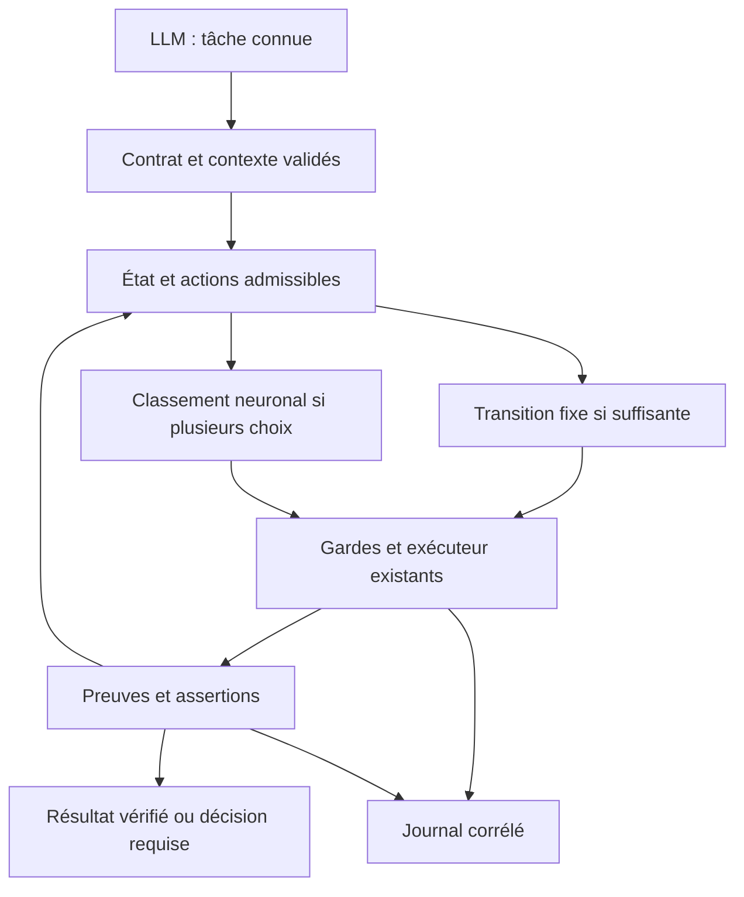

# Spécification du moteur décisionnel Atelier Routines

Date : 30 octobre 2026. Statut initial : spécification proposée. Le périmètre retenu ensuite est uniquement la [collecte descriptive](README.md#collecte-descriptive), pour évaluer l’intérêt de règles ou d’un modèle. Les contrats d’agent, l’architecture neuronale, le dataset d’entraînement et le benchmark étendu ci-dessous restent des propositions.

## 1. Résultat recherché

Le LLM doit pouvoir confier une tâche connue à Atelier Routines, puis récupérer un résultat vérifié, sans choisir chaque inspection, interpréter chaque reçu ou surveiller un calcul. Le moteur reçoit un nom de tâche et son contexte déjà enregistré ; il choisit parmi des opérations autorisées, les enchaîne et rend la main seulement à la fin ou lorsqu’une décision extérieure est nécessaire.

La première économie vient des recettes et des transitions déterministes. Le petit réseau intervient uniquement lorsque plusieurs actions admissibles restent possibles. Il ne remplace ni les gardes, ni les assertions, ni les autorisations. Le monitoring d’un processus connu reste une attente backend : aucun réseau neuronal n’est nécessaire pour attendre sa fin.

Cette spécification fixe la collecte, le contrat de délégation, les surfaces modifiables, une architecture chiffrée et une évaluation contre la mémorisation. Les dimensions et seuils proposés sont des hypothèses à départager sur les données. Une optimalité à 100 %, une économie donnée ou une réussite au premier entraînement ne peuvent pas être établies avant ces mesures.

## 2. Périmètre et preuves de l’audit

### Révision et limites

Audit du dépôt Routines à la révision `10ad2d2758146fb9e4b835bce53e502de034a9bf`, avec arbre de travail initial propre. Le serveur interrogé a déclaré l’empreinte moteur `bea50f4afb0e6fbbcca829af888ff0291340982f90830490d6cc03afa3e07760`. Ces deux identifiants décrivent des objets différents ; leur équivalence n’est pas supposée.

L’inspection couvre les deux outils MCP, le catalogue, l’exécuteur, les recettes, le suivi d’exécution, le routage, les hooks d’attente, le cycle VPS, le benchmark existant et les workflows CI. Il s’agit d’un audit de conception et de traces, sans exécution de la suite de tests. Les reçus historiques de vérification ne valent pas validation de la présente révision.

Le projet de référence confirmé est `/Users/guillaumegaillard/Documents/perso/tacticfront`. Les inspections MCP et la lecture context-mode étaient limitées au projet Routines ; la lecture ciblée des sources autorisées a ensuite permis la comparaison de la section 13, sans élargir ces outils. Elle porte sur le code et la documentation locale, pas sur une nouvelle exécution des campagnes ni sur la vérification de tous leurs artefacts. Les poids jouables n’ont pas été chargés ou modifiés.

L’inventaire du dossier parent ChatGPT a été partiel ; aucune conclusion d’exhaustivité n’en est tirée. L’inventaire propre à Routines a renvoyé 40 fichiers sans signal de parcours partiel. Certains retours MCP étaient raccourcis : les sources et les preuves utiles ont été consultées séparément, sans traiter leur aperçu comme un contenu complet.

### Usage observable avant cet audit

Le premier reçu créé par cet audit a pour date de fichier `2026-10-30T17:53:15.908014Z` et pour référence `ff0ff3af9bcc4c37a1688c6f626ee2b9`. Les comptages suivants excluent les enregistrements à partir de cette limite. La date de fichier des preuves est un repère local, pas un horodatage métier fiable pour une future ingestion.

| Source locale | Enregistrements antérieurs | Volume JSON | États observés | Information exploitable |
| --- | ---: | ---: | --- | --- |
| `output/routines-evidence/*.json` dans Routines | 34 | 38 967 octets | 33 `ok`, 1 `error` | Reçus et résultats d’opérations, dont 17 `git.status` et 6 `checks.regression` |
| `~/.local/share/atelier-routines-executions/*.json` | 76 | 93 848 octets | 74 `ok`, 2 `error` | Suivi global, dont 20 `files.json`, 16 `git.status`, 9 `project.search` et 6 `checks.regression` |

Les deux sources se recouvrent : **34 + 76 n’est pas un nombre de tâches ni d’exemples indépendants.** Aucun plafond de scan n’a été atteint dans cette extraction. Le suivi global mélange des projets et peut contenir des opérations de recette. L’absence de provenance suffisante empêche de séparer sûrement usage réel, tests et essais.

Sur les 76 suivis, 21 possèdent une `request_key` non vide. Aucun ne porte de champ de tâche/instruction/épisode ni de mesure d’usage LLM. Les reçus du projet n’en portent pas non plus. Une répétition de `git.status` ne démontre pas un appel inutile : les changements d’état et les intentions manquent. Le corpus actuel sert à inventorier les opérations et les coûts observés, pas à entraîner directement une bonne politique.

### Capacités déjà présentes

| Élément | Constat vérifié dans les sources | Conséquence |
| --- | --- | --- |
| Interface MCP | Deux outils, `routines_find` et `routines_run`, avec paramètres externes stricts | Conserver ces deux outils ; étendre les routines, pas le nombre d’outils |
| Catalogue | 113 entrées : 39 avec schéma exécutable, 71 guidées et 3 propositions exclues | Une description de procédure n’est pas une action autonome disponible |
| Disponibilité | Les 39 schémas restent soumis aux prérequis de la machine | Le masque d’actions doit intégrer la disponibilité actuelle |
| Recettes | Définitions bornées, schémas fermés, étapes d’inspection autorisées, 8 étapes maximum et définition limitée à 16 Kio | Réutiliser le registre et sa validation ; ne pas fabriquer un interpréteur de scripts |
| Exécution | `execution_id`, empreinte des paramètres et du moteur, états persistés, preuves et empreintes d’artefacts | Réutiliser la reprise et la collecte existantes |
| Idempotence | `request_id` facultatif, clé hachée et récupération d’une demande connue | Lier la demande à un épisode ; ne pas confondre récupération et nouvelle soumission |
| Fraîcheur | Les reçus historiques sont signalés ; les preuves absentes ou modifiées bloquent leur réutilisation | Une réussite passée n’est jamais une observation actuelle implicite |
| Attente | `jobs.wait`, `executions.wait`, reprise et cycle VPS ; garde d’identité du processus | Supprimer les réveils LLM de monitoring en conservant ces backends |
| Réponses | Réduction progressive du JSON autour de 1 950 octets, drapeau `response_truncated` | Préserver les champs de vérité et les références, même lorsque le détail reste hors contexte |
| Benchmark | Trois scénarios synthétiques, transport MCP réel, appels, octets et durées ; pas de tokens réels ni d’inférence LLM | Garder ce contrôle de transport, ajouter une évaluation de tâches complètes |

Les points d’entrée principaux sont [mcp_server.py](scripts/mcp_server.py), [executor.py](scripts/executor.py), [workflows.py](scripts/workflows.py), [executions.py](scripts/executions.py), [routing_hook.py](scripts/routing_hook.py), [codex_hook.py](scripts/codex_hook.py), [wait_hook.py](scripts/wait_hook.py), [jobs.py](scripts/jobs.py), [vps_cycle.py](scripts/vps_cycle.py) et [verify.py](scripts/verify.py).

## 3. Lacunes à traiter en priorité

| Priorité | Lacune | Effet actuel | Réponse prévue |
| --- | --- | --- | --- |
| P0 | Pas de lien instruction → tâche → décisions → résultat vérifié | Impossible d’apprendre pourquoi une action a été choisie | Épisode et transitions corrélés, phrase d’origine et contrat immuable |
| P0 | Un statut `ok` d’outil ne prouve pas l’objectif utilisateur | Risque d’apprendre à terminer trop tôt | Séparer réussite d’opération, assertions métier et clôture de tâche |
| P0 | Pas d’usage LLM de bout en bout | Toute économie de tokens serait spéculative | Adaptateur de mesure côté client LLM, avec provenance et couverture |
| P0 | Les refus et recherches ne passent pas tous par le registre d’exécution | Le dataset omet des décisions et des échecs importants | Événements d’entrée avant validation, y compris `find`, refus et indisponibilité |
| P0 | Tout journaliser brut exposerait des données et contaminerait les entrées | Risque de secrets, de contenu non fiable et de stockage incontrôlé | Assainissement avant écriture, références plutôt que copies, séparation faits/instructions |
| P1 | Les hooks rappellent/routent mais ne constituent pas un enregistreur complet | Une partie des actions du client reste invisible | Adaptateurs de capture déclarant précisément leurs surfaces couvertes |
| P1 | Les recettes d’inspection ne sont pas une politique adaptative | Le LLM choisit encore les branches et interprète les résultats | Automate de tâche borné, puis classement neuronal des choix admissibles |
| P1 | Les appels sans épisode perdent le contexte de reprise | Difficile de reconnaître doublon, attente légitime ou abandon | Identité de tâche stable, liens parent/enfant et événements de récupération |
| P1 | Benchmark à fixtures fixes et une mesure par scénario | Pas de preuve de généralisation ni de gain réel en boucle fermée | Générateur de tâches composées, jeux cachés et comparaison appariée |
| P2 | Taille et qualité du corpus inconnues par famille métier | Surdimensionnement ou faux sentiment de données suffisantes | Tableau de couverture, courbes d’apprentissage et sélection du plus petit modèle suffisant |

La fonction `redact` actuelle masque certains motifs de secrets. Elle ne constitue pas une garantie d’assainissement de transcriptions complètes. Étendre la collecte exige une politique par champ, testée avant écriture, sans supposer que la redaction d’un aperçu protège son original.

## 4. Répartition du travail

| Travail aujourd’hui susceptible de revenir au LLM | Traitement cible | Apport éventuel du réseau |
| --- | --- | --- |
| Retrouver une routine connue | ID/alias enregistré et cache lié à la version du catalogue | Classer des correspondances ambiguës parmi les seules routines admissibles |
| Préparer paramètres et chemins | Contrat typé, valeurs explicites, schémas fermés | Aucun paramètre arbitraire généré |
| Choisir l’inspection suivante | Graphe de dépendances et candidats déterminés par les préconditions | Classer les inspections réellement interchangeables |
| Décider si un résultat suffit | Assertions déterministes de la tâche | Estimer l’utilité d’un candidat, sans valider le résultat |
| Lire un long log | Parseur borné, catégories et pages de preuve ciblées | Choisir quelle catégorie approfondir |
| Surveiller un processus ou un VPS | Attente backend sur une référence connue, puis collecte | Aucun réveil périodique neuronal ou LLM |
| Reprendre après interruption | Registre existant, identité de processus/job, même `execution_id` | Choisir une collecte admissible, sans resoumettre |
| Réutiliser une preuve | Vérification actuelle de la source, du contenu, de la révision et du périmètre | Classer la vérification utile, sans décider seul de la fraîcheur |
| Comparer deux reçus | `reports.compare`, identité de périmètre, différences structurées | Prioriser un diagnostic parmi des différences déjà constatées |
| Réduire le retour au LLM | Reçu structuré borné, faits nouveaux et références de détail | Aucun texte libre nécessaire dans le chemin courant |
| Réessayer après un échec | Politique existante, cause et nouvelle hypothèse explicites | Aucun redémarrage automatique d’un calcul |
| Publier, fusionner, supprimer ou modifier une autorisation | Workflow et consentements humains existants | Hors pouvoir du modèle |

Le réseau ne doit pas être appelé lorsqu’il reste une seule action autorisée, lorsqu’une recette fixe répond déjà au besoin, ni lorsqu’un prérequis manque. Cela économise aussi les appels locaux et les données d’entraînement redondantes.

## 5. Contrat de délégation

### Un nom suffit seulement avec un contexte déterminé

Chaque nom canonique référence une définition versionnée comprenant : objectif, entrées, racines accessibles, routines admissibles, préconditions, graphe de dépendances, assertions finales, budget d’actions, échéance et règles de sortie. L’autorisation provient de l’appelant et des contrôles existants, jamais du libellé de la tâche.

L’interface reste `routines_run`, avec une nouvelle routine proposée `agent.run`. Ses paramètres contiennent le projet, le nom de tâche et les entrées du contrat. La phrase d’intention est facultative lorsque le registre possède déjà le libellé canonique. Le `request_id` externe conserve son sens actuel. Les clients existants restent valides : ne pas ajouter de champs obligatoires à tous leurs appels.

« Seulement le nom » correspond à une tâche et un contexte préenregistrés non ambigus. Un nom seul ne permet pas d’inventer le projet, le PID, le job, la branche, l’API, les assertions ou une permission. Si plusieurs exécutions correspondent, le moteur renvoie `decision_required` avec les champs manquants. Aucun choix silencieux de projet ou de processus.

Familles initiales proposées : revue d’état de projet, diagnostic d’échec à partir d’un log identifié, collecte d’une exécution connue et vérification d’un résultat selon un contrat enregistré. La vérification longue ne s’étend qu’aux adaptateurs déjà autorisés, notamment `checks.regression` pour ce dépôt. Les tâches de modification de code, de publication et les appels arbitraires à d’autres connecteurs restent hors première délégation.

### Cycle interne

1. Enregistrer l’intention et la demande avant toute action ; valider schéma, contexte et autorisation.
2. Retrouver l’épisode correspondant au `request_id`, sans créer une seconde exécution si l’accusé de réception a été perdu.
3. Réduire les observations fiables en état courant ; évaluer les transitions déterministes et les préconditions.
4. Construire la liste des actions admissibles. Si elle est vide, expliquer le blocage ; si elle est unique, l’exécuter directement.
5. S’il reste plusieurs choix, appliquer le classement du modèle activé pour cette famille, ou la politique fixe de référence.
6. Revalider immédiatement droits, ressources et préconditions au moment de l’exécution ; un score ne vaut pas permission.
7. Persister résultat, preuves, validation et nouvel état. Revenir au point 3 sans passage par le LLM.
8. Clore seulement lorsque les assertions du contrat sont satisfaites, ou rendre la main avec la référence et la cause précise.

Le cycle respecte un budget fixe par tâche, proposé à 16 actions pour les premières familles. Ce plafond ne modifie pas la limite de 8 étapes des recettes existantes. Une nouvelle itération doit apporter une observation pertinente ou une transition attendue. Un même échec avec les mêmes entrées ne justifie pas une boucle. Un calcul soumis n’est jamais relancé pour résoudre une incertitude sur son état.

### État et résultat

Conserver les états externes existants, notamment `running`, `guided`, `unavailable`, `partial`, `error`, `timeout`, `decision_required` et `abandoned`. Ils n’acquièrent aucune signification de réussite parce qu’un modèle les prédit. Ajouter une vue de tâche séparant `operation_state`, `validation_status`, `objective_satisfied` et `facts_current`.

Une clôture réussie exige un code de sortie connu lorsque pertinent, les artefacts attendus, leur intégrité, les assertions du contrat et une preuve de périmètre actuel. La disparition d’un PID, un flux fermé ou le silence restent des observations incomplètes. Une réponse raccourcie conserve toujours état, validation, fraîcheur, `execution_id`, références de preuve et motif d’une décision requise.

L’exécution longue conserve le backend et les attentes existants. Une expiration rend une référence récupérable, sans nouvelle soumission. Pas de démon de monitoring supplémentaire, ni de commentaire périodique en l’absence de changement utile. Le modèle peut disparaître ou être désactivé pendant l’attente sans affecter le calcul déjà soumis.

## 6. Collecte à mettre en place en premier

### Sens de « tout sauvegarder »

Enregistrer toutes les **actions observables couvertes** : demandes, recherches, choix, entrées assainies, reçus, attentes, interruptions, reprises, validations et sorties. Enregistrer aussi les erreurs et les refus. Cela ne donne pas accès au raisonnement interne du LLM, ni aux outils ou messages que le client n’expose pas.

Trois niveaux sont distincts :

| Niveau | Contenu | Conservation proposée |
| --- | --- | --- |
| Journal d’apprentissage | Identités, intention assainie, état antérieur, candidats, action, coût observable, preuve et résultat | Par défaut, borné par le quota du store |
| Preuves d’exécution | Fichiers déjà produits par Atelier ; références et empreintes dans le journal | Propriété et règles actuelles conservées, aucune duplication systématique |
| Contenu détaillé facultatif | Extraits assainis de messages ou de réponses nécessaires à un cas | Activation explicite par périmètre, taille et durée ; jamais un dump global du poste |

Préserver la phrase originale assainie, sa langue, le nom canonique et la provenance de cette association. Si une phrase n’est pas observable, conserver `intent_missing` plutôt qu’en inventer une après coup. Le libellé canonique et les alias fournissent une phrase déterministe sans demander au LLM d’en rédiger une à chaque étape.

### Identités et journal d’événements version 1

| Groupe | Champs requis ou explicitement absents |
| --- | --- |
| Schéma et ordre | `schema_version`, `event_id`, `event_type`, séquence par producteur, date UTC et durée monotone, version du collecteur |
| Corrélation | `session_id` pseudonymisé, `task_id`, `episode_id`, parent éventuel, référence de demande, `execution_id` lorsqu’il existe |
| Intention | Phrase assainie/référence, langue, nom canonique, version du contrat, provenance `user`/`registry`/`client`/`unknown` |
| Sources | Client, transport MCP/CLI/hook/backend, version moteur/catalogue/recette, révision et empreinte du périmètre |
| Avant décision | Référence d’état, champs disponibles et manquants, observations utilisées et leur fraîcheur, candidats et masque de disponibilité |
| Décision | Action choisie, paramètres typés assainis ou références, origine `rule`/`llm`/`model`/`human`, raison structurée, modèle et scores si utilisés |
| Exécution | Références PID avec identité de démarrage ou job VPS, début/fin, état connu/inconnu, code de sortie, attente, interruption et reprise |
| Résultat | Statut d’opération, validation, assertions attendues/exécutées/réussies, objectif satisfait ou non vérifiable, preuves et empreintes |
| Coût | Durées, appels externes/internes séparés, octets, usage LLM avec couverture et provenance, ressources mesurées si disponibles |
| Qualité | Réel/synthétique/rejeu/inconnu, erreurs de capture, troncature, redaction, label/oracle et maturité de l’épisode |

Les événements minimaux sont : intention observée, tâche ouverte, recherche effectuée, décision proposée, opération demandée, refus, démarrage, attente, résultat observé, preuve collectée, validation, reprise, interruption, tâche clôturée et incident de collecte. Un événement de résultat n’écrase pas l’événement de décision antérieur.

Un événement est append-only, identifié et dédupliqué. Une reprise peut produire une livraison répétée : la déduplication ne réexécute pas l’action. La demande est liée à une référence locale opaque ; ne pas exposer sa valeur personnelle dans un export. Les grandes observations sont référencées, pas répétées dans chaque ligne.

### Points d’intégration

| Surface | Point existant à étendre | Capture attendue et limite |
| --- | --- | --- |
| MCP | `mcp_server.call_tool` | Entrée/sortie, y compris `routines_find`, schéma invalide, refus et exception avant création d’exécution |
| CLI | Dispatch de `scripts/routines.py` | Même contrat d’événement que MCP ; ne pas compter deux actions lorsque les couches se recouvrent |
| Exécuteur | `executor.run` et gestion des preuves | Relier demandes, résultats et preuves sans modifier le sens des statuts |
| Recettes | `workflows.execute` | Une étape par transition, liens avec la recette et ses entrées |
| Registre | `executions.begin/finish/dispatch` | Identité persistante, récupération, idempotence, correction après interruption |
| Monitoring | `jobs.py`, `wait_hook.py`, `vps_cycle.py` | Attente côté backend, transitions significatives et collecte, sans événement à chaque seconde |
| Client LLM | Adaptateur du client ou export documenté | Instruction et usage réel si exposés ; champs absents sinon |
| Hooks | Adaptateurs d’événements disponibles | Demandes et outils réellement exposés ; aucune promesse de couverture globale à partir de `PreToolUse` seul |

Les hooks restent des adaptateurs : ne pas transformer leur mécanisme de rappel en source d’autorisation. Prévoir un manifeste de couverture par client et version. Un épisode qui traverse une surface non instrumentée porte une lacune explicite ; il ne reçoit pas un label de trajectoire complète.

### Confidentialité et confiance des données

Assainir avant toute écriture : champs de secrets retirés, chemins pseudonymisés avec mapping local privé si nécessaire, taille par champ bornée et références vers les preuves existantes. Ne pas enregistrer les valeurs d’environnement, en-têtes d’authentification, clés privées, cookies ou profils navigateur. Ne jamais ouvrir, indexer ou intégrer `CLAUDE.md`.

Les logs, fichiers de dépôt et sorties d’outils restent des données non fiables. Ils ne peuvent ni modifier le contrat ni ajouter une routine, une commande, un chemin accessible ou une permission. Le texte d’une instruction ne doit pas devenir du shell. Les opérations sont exclusivement des IDs connus avec schéma fermé.

Les exports d’entraînement retirent chemins réels, identités personnelles et contenu non nécessaire. Des tests de canaris de secrets vérifient les fichiers persistés, les erreurs, les aperçus et les exports, pas seulement le retour MCP. Les preuves historiques préexistantes sont préservées ; aucune migration ne les purge ou ne les réécrit silencieusement.

### Durabilité et défaillances

Un store SQLite local, avec journal WAL et écrivain unique, suffit au premier volume. Utiliser les bibliothèques déjà installées et la bibliothèque standard ; pas de base vectorielle ni de service distribué. Le mode WAL demande une gestion explicite de ses fichiers et checkpoints ; éviter le partage du fichier SQLite sur un système de fichiers réseau. Voir la [documentation SQLite WAL](https://sqlite.org/wal.html).

Écriture transactionnelle avant accusé de réception des transitions critiques, synchronisation durable, versions de schéma et déduplication par `event_id`. Une file mémoire bornée à 256 événements de 4 Kio au plus représente environ 1 Mio de charge utile ; elle ne suffit pas à garantir la persistance d’une action acceptée. Les grandes charges restent dans des blobs assainis référencés ou dans les preuves existantes.

Une panne de collecte ne doit pas masquer un calcul en cours, le tuer ou le relancer. Conserver sa référence. Pour la nouvelle délégation, ne pas démarrer une étape qui exige une traçabilité durable si l’intention ne peut pas être persistée. Le client existant doit recevoir un incident explicite et conserver un chemin de fonctionnement antérieur ; aucune réussite complète d’apprentissage n’est attribuée à un épisode troué.

## 7. Transformer les traces en dataset

### Unités et labels

Une tâche peut avoir plusieurs épisodes de prise en charge ; une reprise reste reliée à la même tâche. L’unité d’apprentissage décisionnelle est `(état avant action, candidats admissibles, choix, résultat vérifié)`. L’unité de mesure et de séparation des jeux est le problème complet avec sa lignée, pas la ligne de log.

| Donnée | Utilisation permise |
| --- | --- |
| Reçus historiques isolés | Inventaire d’actions, distribution de durées, erreurs et formats ; pas d’instruction ou de décision reconstruite arbitrairement |
| Décision LLM suivie d’une assertion réussie | Démonstration possible, avec origine du label ; cela ne prouve pas que le choix était optimal |
| Action déterministe unique | Vérification des invariants ; faible poids dans le classement pour éviter un dataset artificiellement facile |
| Cas synthétique à oracle exact | Action admissible, terminaison, preuve et coût de référence ; provenance distincte du réel |
| Épisode interrompu ou incomplet | Exemple censuré/incomplet, jamais échec ou réussite finale inventés |
| Candidats non exécutés | Résultat inconnu, sauf oracle de sandbox ayant réellement établi leur résultat |

Les échecs d’action, refus, données manquantes, preuves périmées et bonnes abstentions sont conservés. Un refus correct n’est pas une mauvaise performance. Le statut de tâche est étiqueté par les assertions et le backend, jamais par une phrase de succès du LLM.

Les coûts et résultats futurs peuvent servir de **cibles**, jamais de caractéristiques disponibles au moment de la décision. Les signatures de résultat, le statut final, le nombre total futur d’étapes et les sorties d’assertion postérieures sont interdits dans l’état d’entrée.

### Qualité et constitution du premier jeu

Avant entraînement : valider schéma, corrélation, ordre causal, complétude, assainissement, provenance, intégrité des références et cohérence des labels. Chaque export possède un manifeste immuable avec empreintes, versions, filtres et exclusions motivées.

Point de départ de planification : environ 1 000 tâches réelles closes et 10 000 décisions utilisables, complétées par des cas difficiles à oracle exact. Ce n’est pas une garantie de suffisance ni un quota à attendre si les critères sont déjà démontrés. Une famille n’est activable que si ses cas nominaux, ses exceptions et ses abstentions ont une couverture vérifiable ; viser initialement 200 problèmes clos et 100 cas difficiles indépendants par famille candidate, en distinguant réel et injecté. La courbe d’apprentissage et les intervalles d’évaluation déterminent si davantage de données est nécessaire.

Échantillonner par famille, lignée de problème et épisode. Limiter le poids des tâches longues et des répétitions identiques. Le synthétique ne doit pas dominer silencieusement le réel : rapporter les scores séparément et plafonner initialement sa contribution à 50 % du poids de perte. Ce plafond est un choix de protocole, à modifier sur validation seulement.

Les corrections humaines ou LLM sur des états difficiles enrichissent l’entraînement, avec coût et provenance. Aucune annotation LLM systématique de chaque log : extraire les labels exacts quand le contrat le permet et réserver l’annotation aux ambiguïtés. Ne jamais exploiter les corrections du jeu de test pour le même cycle d’évaluation.

### Séparation contre les fuites

Créer les séparations avant l’augmentation. Tous les rejeux, paraphrases, renommages et permutations d’un même problème de base appartiennent au même groupe. Une signature de lignée relie fixture source, contrat source, scénario d’incident et variantes dérivées ; la déduplication recherche aussi les copies quasi identiques.

Proposition : 70 % entraînement, 15 % validation, 15 % test caché, par groupes de problèmes et après vérification du nombre de groupes indépendants. La validation contient un sous-ensemble distinct pour la calibration. Les proportions s’adaptent au volume, sans mélanger une lignée entre jeux.

Ajouter des évaluations séparées sur des projets laissés de côté, une période ultérieure, des compositions de tâches inédites, des types d’incidents réservés et une version différente du catalogue. Ne pas regrouper aveuglément tout un domaine dans une seule lignée : un audit de distribution doit détecter les jeux impossibles ou déséquilibrés. Changer seulement la seed ou les noms de fichiers ne constitue pas un holdout structurel.

## 8. Architecture neuronale proposée

### Choix initial

Le moteur est un classeur d’actions sur état structuré. La tâche canonique est connue du registre ; il n’a pas besoin de produire du texte ni d’encoder tout un historique de conversation. Conserver la phrase pour le dataset permet d’apprendre ultérieurement un routeur d’intention si les alias ne suffisent pas. Ce routeur n’est pas requis pour déléguer une tâche nommée.

Proposition initiale : **MLP partagé de 128 entrées, couches de 64 puis 32 unités, deux sorties par candidat ; 10 402 paramètres. Zéro tête d’attention. Deux têtes de sortie.** L’état courant et le graphe du contrat portent la mémoire utile ; aucun Transformer, LSTM ou moteur génératif n’est présupposé. C’est le même principe de classement de candidats que dans tacticfront, avec des observations et des cibles propres aux opérations d’Atelier.

| Bloc | Paramètres |
| --- | ---: |
| Couche 128 → 64, biais compris | 8 256 |
| Couche 64 → 32, biais compris | 2 080 |
| Tête de classement 32 → 1 | 33 |
| Tête de résultat vérifiable 32 → 1 | 33 |
| Total | 10 402 |

Poids float32 : 41 608 octets, environ 40,6 Kio, hors manifeste, normalisation et runtime. Cette taille ne décrit pas la RAM du processus Python ni le coût de chargement. Aucune quantification n’est justifiée à ce stade.

Ce choix est une hypothèse de faible coût sur des données structurées. La littérature sur les données tabulaires ne désigne pas d’architecture universellement supérieure ; elle justifie une comparaison avec des références simples plutôt que la copie d’un réseau de jeu. Voir [Revisiting Deep Learning Models for Tabular Data](https://arxiv.org/abs/2106.11959).

### Entrées et candidats

Allocation initiale des 128 caractéristiques, à figer dans un dictionnaire versionné avant le gel du dataset :

| Groupe | Dimensions | Contenu prévu |
| --- | ---: | --- |
| Contrat de tâche | 32 | Famille canonique, type d’objectif, dépendances et budgets définis avant exécution |
| État observable | 48 | États d’opération, disponibilité et fraîcheur des preuves, identité backend connue, prérequis/services, ressources et progression du contrat |
| Historique réduit | 16 | Dernière transition, catégories d’échecs déjà rencontrés, répétitions équivalentes et budget restant |
| Candidat | 32 | Type d’action enregistré, apport attendu de preuve, préconditions, coût observé sur entraînement et nouveauté par rapport aux inspections déjà faites |

Le dictionnaire devra énumérer chaque champ, son unité, sa source, son instant de disponibilité, sa transformation et sa valeur d’absence. Normalisation apprise sur entraînement uniquement. Pas de chemin brut, timestamp absolu, identifiant d’épisode, ordre de candidat ou signature de fixture permettant de reconnaître le jeu. Une donnée critique absente impose un arrêt ou une collecte déterministe, pas une valeur rassurante inventée.

Les candidats proviennent exclusivement du contrat et du catalogue exécutable disponible, avec paramètres déjà résolus par les schémas et références. Une procédure `guided` n’entre pas comme action exécutable. Les propositions exclues restent exclues. Les préconditions et l’autorisation sont vérifiées hors réseau, puis revérifiées juste avant l’action.

Le réseau partage ses poids entre candidats ; il ne possède pas une sortie figée pour chacune des 113 descriptions. Son score ne dépend pas de l’ordre de la liste. Traiter les candidats par blocs de 16, avec un maximum initial de 64 par décision. Au-delà, sélectionner un sous-ensemble par une règle du contrat prouvée pertinente ou s’abstenir ; aucune troncature silencieuse.

Placer les 96 valeurs communes en préfixe, puis les 32 valeurs du candidat. Comme `predictMany` dans tacticfront, calculer une seule fois la contribution du préfixe à la première couche et réutiliser les tampons. Le journal et les exports stockent l’état commun une fois, puis les descripteurs ou deltas des candidats. Pour 16 candidats, le calcul dense naïf représente 164 864 multiplications contre 72 704 avec ce partage, hors biais, activations et extraction ; ce décompte n’est pas une mesure de latence.

### Têtes, apprentissage et abstention

La première tête produit un score de classement parmi les candidats admissibles. La seconde estime si l’action choisie produira une observation utilisable et vérifiable pour ce contrat. Sa cible décrit le résultat d’action connu ; elle ne déclare pas la tâche réussie. Les candidats non exécutés restent sans cible de résultat, sauf oracle explicite.

Les deux couches cachées utilisent ReLU ; le classement produit un logit linéaire et la seconde sortie une probabilité sigmoid. À l’exécution, choisir le meilleur candidat admissible si les portes de délégation sont satisfaites ; aucun échantillonnage exploratoire. L’évaluation utilise exactement cette politique. À l’entraînement, le classement est normalisé sur la liste des candidats admissibles de la décision, sans exposer de sortie pour une action interdite.

Apprentissage supervisé : perte de classement sur démonstrations valides ou préférences établies par oracle, et perte binaire masquée sur les résultats d’action connus. Pondérations fixées sur validation. Ni simple copie de toutes les décisions LLM, ni récompense positive pour avoir évité un contrôle obligatoire. L’optimisation du coût se fait entre trajectoires correctes, avec coût réel mesuré lorsqu’il existe.

Recette initiale proposée, à enregistrer dans le manifeste : Adam à 0,0003, lots de 64 décisions groupées par listes de candidats, pénalité L2 de 0,0001, poids de perte de résultat de 0,25, au plus 50 époques et arrêt après cinq évaluations sans amélioration sur validation. Les seeds sont fixées avant les essais. Ces valeurs constituent une référence reproductible, pas des hyperparamètres déjà optimisés ; une modification est justifiée par un défaut observé sur entraînement/validation, sans consulter le test caché.

Les scores ne sont pas des probabilités fiables par construction. Calibrer sur le sous-ensemble dédié, par famille si les effectifs le permettent, puis mesurer précision en fonction de la couverture. Un seuil arbitraire de softmax à 0,95 ne suffit pas. La [recherche sur la calibration](https://arxiv.org/abs/1706.04599) motive ce contrôle ; elle ne garantit pas la sûreté de ce moteur.

Abstention obligatoire si contrat inconnu, précondition incertaine, famille non validée, incohérence de versions, entrée hors distribution détectée, candidats invalides ou score insuffisamment fiable. Les seuils de délégation sont fixés avant le test. La politique de référence ou le LLM reprend au même état, avec un reçu compact ; une abstention ne lance pas de recherche autonome illimitée.

Le contrôle minimal de domaine combine versions/familles autorisées, champs critiques présents, catégories connues et plages de caractéristiques qualifiées. Il ne prétend pas détecter tous les changements de distribution. Les jeux de projets, incidents et compositions réservés mesurent précisément les cas qui lui échappent ; une mauvaise couverture bloque l’activation de la famille concernée.

### Dimensionnement et livraison

Comparer au plus trois tailles au premier cycle complet sur le même dataset représentatif :

| Variante | Réseau par candidat | Paramètres |
| --- | --- | ---: |
| Petit | 128 → 32 → 16 → 2 | 4 690 |
| Référence proposée | 128 → 64 → 32 → 2 | 10 402 |
| Plus large | 128 → 128 → 64 → 2 | 24 898 |

Exécuter trois seeds d’entraînement par variante si le budget réservé le permet, avec arrêt anticipé fixé sur validation. Comparer aussi le classement à règles et une référence linéaire. Retenir le plus petit candidat satisfaisant les critères ; garder les règles si le réseau n’apporte rien. Ne pas multiplier les têtes, l’attention ou les embeddings avant d’avoir identifié un échec mesurable de représentation.

L’inférence doit rester CPU, sans GPU, sans réseau et sans téléchargement de modèle. Réutiliser un runtime numérique déjà présent s’il satisfait le packaging ; sinon mesurer d’abord le coût d’un calcul de cette taille avant d’ajouter une dépendance. L’entraînement hors ligne peut utiliser un environnement déjà installé sur VPS ; il ne doit pas alourdir le runtime MCP.

Objectifs de budget à mesurer : surcoût mémoire chargé inférieur à 32 Mio, classement p95 inférieur à 50 ms pour 16 candidats sur un CPU, charge froide rapportée séparément. Ces valeurs sont des critères, pas des mesures acquises. Le budget de l’épisode inclut aussi extraction de caractéristiques, sérialisation, journalisation et politique de repli.

Le paquet livré contient poids non exécutables, dimensions, normalisation, vocabulaire, hashes, versions de schéma/catalogue/contrat compatibles et manifeste de benchmark. Aucun pickle ni chargement de code depuis un checkpoint. Un modèle manquant, altéré ou incompatible désactive le classement et conserve les fonctions existantes.

## 9. Taille et gestion du store

### Enveloppe initiale proposée

Conserver un seul store local privé, distinct des preuves sources et des temporaires de QA. SQLite tient l’index et les événements structurés ; les blobs facultatifs sont assainis et adressés par contenu. Aucun besoin démontré de base vectorielle, de recherche sémantique distante ou de réplication permanente.

| Poste nouveau | Plafond initial proposé |
| --- | ---: |
| Événements, index, WAL et fichiers SQLite associés | 256 Mio |
| Blobs assainis facultatifs, sans recopier les preuves existantes | 512 Mio |
| Caractéristiques dérivées réutilisables | 64 Mio |
| Export d’entraînement gelé utile | 256 Mio |
| Modèles et comparaisons encore nécessaires | 32 Mio |
| Manifestes et résultats de benchmark compacts | 64 Mio |
| Total des postes | 1 184 Mio |

Avec un shard transitoire plafonné à 64 Mio et un petit tampon, viser un plafond global de **1,25 Gio**. Le pic admissionné initial est **2 Gio** pour inclure les transactions, la rotation et l’écriture atomique d’un export. Toute sauvegarde ou version supplémentaire doit entrer dans un nouveau calcul de pic, pas être exclue du quota. Ces plafonds concernent le nouveau store ; les sources et preuves existantes ne deviennent pas purgeables.

Ordres de grandeur de planification : 100 000 événements à 1 Kio représentent environ 97,7 Mio avant index et WAL ; 20 000 vecteurs de 128 float32 représentent environ 9,8 Mio, avant candidats et métadonnées. Avec 16 candidats par décision, le stockage partagé de 96 valeurs d’état et de 16 × 32 valeurs de candidat représente environ 46,4 Mio pour 20 000 décisions, contre 156,25 Mio pour 16 copies d’un vecteur dense de 128 valeurs. Les IDs, labels, index et manifestes s’ajoutent. Mesurer les octets réels par événement/décision et le nombre de candidats. Ne pas déduire la capacité utile du seul nombre de lignes.

### Saturation et conservation

À 80 % du plafond, signaler la tendance une fois et arrêter les enrichissements facultatifs. À 95 %, suspendre la nouvelle collecte détaillée et les nouveaux exports ; préserver les événements critiques si leur espace réservé le permet. À saturation, annoncer un incident de capture et empêcher toute prétention de dataset complet. Ne pas supprimer des données pour donner l’illusion de continuer.

La politique de rétention s’applique seulement aux données créées par cette fonctionnalité et identifiées par leur propriétaire/manifeste. Proposition à activer explicitement : extraits détaillés 14 jours, événements opérationnels 90 jours, dataset gelé tant qu’un modèle actif en dépend. Une expiration produit d’abord une liste de candidats ; aucune purge automatique n’est activée par cette spécification. Préserver les cas rares, corrections et preuves nécessaires à la reproduction, sous quota connu.

Avant une collecte, un export ou une copie de plus de 1 Gio, appliquer le garde de stockage installé au pic complet. Conserver les marges permanentes : 10 % libres, au moins 50 Gio sur l’interne et 20 Gio sur disque externe. Un refus bloque l’opération ; ne pas déplacer le store pour le contourner.

Les QA et générations temporaires restent sous le garde canonique, dans `TASK_WORKSPACE`, plafond 5 Gio et logs temporaires `.log/.jsonl` cumulés de 20 Mio. Le store persistant n’est pas un moyen de déplacer des temporaires hors garde. Pas de snapshot de projet manuel ; si nécessaire, utiliser le snapshot autorisé unique et ses exclusions.

## 10. Benchmark de tâches composées

### Ce qui doit être comparé

| Bras | Comportement | Ce qu’il isole |
| --- | --- | --- |
| A | LLM et parcours d’outils antérieur autorisé | Référence informative du coût total avant regroupement |
| B | Atelier actuel, recettes et transitions déterministes | Référence principale : ce qui est économisable sans modèle |
| C | Même exécuteur et mêmes gardes, avec classeur neuronal | Gain propre de la décision apprise |
| D | Classement de C en observation seulement | Désaccords et couverture, sans économie d’exécution revendiquée |

Utiliser le même objectif, les mêmes assertions, les mêmes permissions, budgets et états initiaux. La comparaison principale est **C contre B**, pour ne pas attribuer au réseau les gains déjà obtenus par les routines. D n’est pas un bras plus économique : il ajoute du travail pendant la mesure.

### Générateur rejouable

Construire une grammaire de tâches représentatives à partir des contrats : inspections Git, recherche littérale, lecture JSON/CSV/log, comparaison de preuves, diagnostic d’un échec, suivi d’une exécution et collecte. Un scénario produit un graphe valide de dépendances et un oracle indépendant de la politique testée.

| Axe variable | Exemples |
| --- | --- |
| Composition | Deux diagnostics indépendants, dépendance collecte → vérification → comparaison, sous-tâche déjà satisfaite, ordre partiel de 2 à 12 étapes |
| Données | Tailles, encodage, champs absents, séparateurs, fichiers sans match, sortie dépassant un plafond |
| État du travail | Arbre Git changé ou inchangé, révision cible différente, preuve valide/périmée/altérée, nouvelle observation utile ou bruit |
| Disponibilité | Service prêt ou absent, API nécessaire non démarrée, outil manquant, ressource VPS refusée, résultat distant non encore collecté |
| Incidents | Accusé perdu, interruption après soumission, livraison répétée, timeout, arrêt du client, PID réutilisé, résultat partiel, code de sortie inconnu |
| Formulation | Nom canonique, alias français/anglais, paraphrase, instruction ambiguë, instruction et fichier non fiable contradictoires |
| Perturbations | Bruit de log, renommage, ordre des candidats permuté, faits non pertinents ajoutés, décalages de durée |
| Frontières de confiance | Demande hors racine, secret canari, tentative de shell dans un paramètre, faux succès dans un log, contenu d’injection |

La génération doit offrir un très grand espace combinatoire avec des seeds et des versions de grammaire enregistrées. Cet espace est fini ; son volume ne prouve ni indépendance des cas ni absence de mémorisation. Les séparations structurelles et la provenance sont indispensables. Les résultats de [Procgen](https://arxiv.org/abs/1912.01588) motivent une évaluation explicite de la généralisation à des environnements différents, sans transposer ses chiffres à Atelier.

Le générateur rejette une combinaison impossible ou la marque comme tâche volontairement bloquée avec oracle d’abstention. Il ne transforme pas un prérequis absent en échec imputable au réseau. Toutes les politiques reçoivent exactement le même problème admissible et le même critère de réussite.

### Jeux à maintenir

1. Cas de régression fixes : intégrité des reçus, états, autorisations, reprise, budgets et transport.
2. Tâches procédurales nouvelles dans les familles connues, réservées par lignée.
3. Compositions inédites et ordres de dépendance non vus à l’entraînement.
4. Projets, période, versions et incidents hors distribution, évalués séparément.
5. Corpus réel gelé et assaini, sans réétiquetage à partir des prédictions du candidat.
6. Cas adverses de confiance et d’interruption, avec assertions indépendantes.

Tests métamorphiques : renommer sans changer la sémantique ne change pas la décision ; permuter les candidats ne change pas l’action choisie ; ajouter un log sans rapport ne change pas la clôture ; altérer une preuve ou rendre un service indisponible doit changer le comportement attendu. Une même phrase avec deux contextes différents doit pouvoir conduire à deux choix différents.

La simulation accélère la couverture des incidents. Elle ne remplace pas les scénarios réels de transport, de backend et d’API. Un E2E n’est vert qu’après démarrage de tous ses services requis et exécution de ses assertions critiques. Les services appartenant à la passe sont fermés après collecte ; les autres sont préservés.

### Mesurer les vrais tokens

Le serveur MCP connaît ses appels et octets, pas l’ensemble du contexte envoyé au LLM ni sa facturation. L’adaptateur de mesure doit se placer au niveau du client qui reçoit l’usage fournisseur. Si ce signal n’est pas exposé, le rapport de tokens est **indisponible ou partiel**, pas estimé à partir d’un ratio caractères/tokens présenté comme réel.

Pour chaque tâche et chaque bras, sommer les catégories d’usage réellement exposées en respectant leur sémantique : entrées totales, portion en cache, sorties et éventuels tokens de raisonnement déclarés dans les métriques, sans double comptage des sous-catégories. Aucun contenu de raisonnement interne n’est demandé. Inclure les définitions d’outils, instructions, rappels, résumés, relances, réintroductions de contexte et chemins de repli lorsque le client les inclut.

Rapporter distinctement tokens réels, estimation locale éventuelle clairement nommée, octets outil et nombre d’appels. Une trace d’outils rejouée sans nouvelle inférence valide un transport, pas une économie réelle de LLM. Les comparaisons utilisent le même modèle LLM, sa version, ses paramètres et une politique de cache documentée ; démarrage froid et session chaude sont séparés.

Réduction de tokens d’une tâche : `(tokens_B − tokens_C) / tokens_B`, seulement si B et C ont une couverture complète et B est non nul. Le bilan de population utilise les sommes pondérées par l’usage réel, pas la moyenne de pourcentages de petites tâches. Rapporter aussi coût par tâche vérifiée, économies perdues sur replis et surcoût d’annotation/entraînement amortissable ; exclure les échecs du dénominateur de réussite serait trompeur.

### Métriques, incertitude et promotion

Mesurer réussite de l’objectif, fausse réussite, contrôles omis, décisions interdites, erreurs de fraîcheur, doublons de soumission, abstention, couverture autonome, longueur de trajectoire, tokens, octets, latence médiane/p95, RAM, volume du store et surcoût de collecte. Produire les résultats par famille et incident, puis un agrégat reflétant l’usage réel.

Utiliser des comparaisons appariées par problème, des intervalles à 95 % regroupés par lignée indépendante et plusieurs seeds LLM lorsque ses choix sont stochastiques. Le nombre effectif est celui des problèmes indépendants, pas celui des paraphrases ni des lignes de log. Déterminer l’effectif selon la marge et la puissance recherchées ; un nombre fixe de scénarios n’assure pas à lui seul une conclusion.

Critères proposés, à figer sur validation avant le test caché :

| Critère | Condition |
| --- | --- |
| Invariants | Zéro action interdite, zéro fausse validation, zéro resoumission involontaire et aucun contrôle obligatoire omis dans les jeux exécutés |
| Résultat | Non-infériorité face à B, marge initiale de 0,5 point de pourcentage, avec intervalle compatible et détail par famille activée |
| Tokens | Borne inférieure de gain positive contre B sur périmètre mesuré ; cible de travail de 70 % sur les familles déléguables, sans promesse de ce niveau |
| Généralisation | Les jeux de compositions et d’incidents réservés satisfont aussi les critères, avec abstention sur l’inconnu |
| Coût local | Budgets mémoire/latence respectés, store borné, surcoût de collecte et de repli inclus |
| Reproductibilité | Manifestes, révisions, seeds, assertions, compteurs et preuves complets |

Zéro incident observé n’établit pas un risque nul : à titre de repère, 3 000 cas indépendants sans incident donnent une borne supérieure unilatérale d’environ 0,1 % à 95 %, pas une garantie. Les contrôles déterministes restent donc indispensables. Un échec d’invariant bloque la promotion quelle que soit l’économie moyenne.

### Boucle de benchmark

Geler données, splits et protocole ; entraîner les candidats bornés ; calibrer et sélectionner sur validation ; évaluer une fois le candidat retenu sur le test caché. Un échec analysé peut devenir un exemple d’entraînement du cycle suivant, avec un **nouveau** test indépendant. Ne pas réutiliser le même test jusqu’à obtenir le score voulu.

Le mode d’observation collecte les états réellement rencontrés et les désaccords. Les corrections rejoignent seulement les futurs jeux d’entraînement autorisés. Le décalage entre états d’apprentissage et états induits par la politique exige une évaluation en boucle fermée ; voir [DAgger et l’apprentissage par imitation](https://arxiv.org/abs/1011.0686). Aucune exploration risquée n’est autorisée en production pour obtenir des labels.

## 11. Intégration et activation

| Lot durable | Résultat attendu | Porte de sortie |
| --- | --- | --- |
| Collecte | Journal versionné, intentions corrélées, refus et interruptions capturés, couverture documentée | Aucun secret canari persisté, pas de perte d’identité, quotas et panne disque testés |
| Délégation déterministe | Contrats de tâches, reprise et retour borné, sans réseau | Tâches complètes vérifiées et mesure de tokens contre l’existant |
| Dataset et benchmark | Manifestes, splits de lignées, générateur compositionnel, oracles et corpus réel | Audit de fuite et assertions indépendantes complets |
| Modèle hors ligne | Classement calibré, paquet reproductible, comparaison des petites tailles | Gain propre contre règles et invariants satisfaits |
| Observation puis activation limitée | Prédictions sans effet, puis familles explicitement activées | Revue du rapport concret, seuils gelés, désactivation et repli validés |

Ces lots sont les composants du produit final, pas des prototypes à jeter ou des entraînements sur des objectifs provisoires. La collecte n’attend pas le modèle ; le moteur déterministe reste utile si aucun réseau ne justifie son coût. Aucune étape de cette spécification n’est activée automatiquement.

L’activation possède des modes explicites : collecte, observation, délégation de familles autorisées. Le modèle ne peut pas se promouvoir lui-même ni élargir ses contrats. Une incompatibilité ou un incident désactive sa sélection pour les nouveaux choix ; les opérations en cours restent attachées à leur backend et à leur propriétaire. Le retour aux règles ne soumet pas une seconde fois le travail.

Les builds, tests portables, traitements de dataset et entraînements CPU vont sur Atelier VPS sous sa politique : lire le guide pertinent, consulter le statut Global, admissionner CPU/RAM/disque, utiliser `arch=any` si portable, conserver la référence et attendre le reçu, récupérer/vérifier les résultats avant libération. Un calcul incertain est préservé. Les sources, Git et les données personnelles restent sur le Mac ; seuls les exports assainis nécessaires sont transférés. Ne pas partager le fichier SQLite actif entre machines.

Les scénarios macOS, hooks réels du client et intégrations avec identifiants personnels restent locaux, sous garde et avec les services déjà en place. Aucun sous-agent ou quota supplémentaire n’est requis. Les dépendances d’entraînement ne sont pas installées dans le serveur MCP par défaut.

## 12. Impacts sur le dépôt et vérifications futures

| Surface à modifier lors de l’implémentation | Travail nécessaire |
| --- | --- |
| `scripts/mcp_server.py` | Corrélation et capture de tous les résultats, schémas des deux outils maintenus compacts |
| `scripts/routines.py` | Même journal pour CLI, propagation du contexte de tâche sans code arbitraire |
| `scripts/executor.py` | Routines de tâche bornées, références de journal, redaction avant persistance et vérification finale des candidats |
| `scripts/executions.py` | Liens tâche/épisode/exécution, reprise et événements durables sans changer l’idempotence |
| `scripts/workflows.py` | Réutilisation des définitions et limites actuelles ; contrat de tâche distinct si ses transitions dépassent une recette |
| Hooks, `jobs.py`, `vps_cycle.py` | Adaptateurs d’observation, attentes et collecte ; aucune boucle de polling LLM |
| `references/catalogue.json` et exemples | Nouvelles routines documentées, disponibilité honnête et définitions de tâches vérifiables |
| `scripts/verify.py` et tests existants | Maintien du benchmark de transport et ajout du benchmark de tâches, fixtures et assertions indépendantes |
| `.github/workflows/checks.yml` | Conservation des suites complètes `verify` et `security`, artefacts utiles bornés |
| README, SKILL, SECURITY et skill installé | Couverture, limites de collecte, modes de repli, compatibilité de version et procédure de désactivation |

Les nouvelles branches de décision, le journal et le chargeur de poids exigent de vrais tests : concurrence d’écriture, crash avant/après soumission, accusé perdu, reprise sans nouveau calcul, redaction avant disque, quota atteint, modèle absent/altéré, horodatages incohérents, refus hors racine, état historique et service API absent. Réutiliser les fixtures et gardes existants ; ne pas ajouter une seconde infrastructure de tests.

Avant une future poussée, lire les workflows applicables et exécuter la non-régression complète ainsi que la sécurité sur la dernière révision. Les validations portables vont sur VPS ; les branches natives sont vérifiées dans leur environnement requis. Un contrôle non exécuté est bloqué, jamais implicitement vert.

L’intégration passe par une branche de travail et une PR avec `verify` et `security` verts sur la dernière révision, branche à jour et protections applicables aux administrateurs vérifiées. Aucun contournement, aucune poussée directe sur la branche d’intégration, aucun changement d’identité Git ou d’attribution. Les conventions Shortcut existantes et la propriété humaine de la clôture des stories restent applicables.

## 13. Comparaison avec le moteur de tacticfront

### Sources examinées et architecture réelle

La lecture ciblée a couvert `docs/NEURAL_MODE.md`, `src/core/neural/Model.ts`, `FeatureSchema.ts`, `FullState.ts`, `Orders.ts`, le lanceur `src/scripts/neural.ts` et les parties pertinentes de `src/scripts/neural/Learning.ts`, `Simulation.ts` et `Development.ts`. Elle n’a exécuté ni partie, ni entraînement, ni test et ne constitue pas une certification des résultats historiques du guide.

Le modèle est un couple de réseaux denses politique/valeur, sans attention ni serveur de modèles. La politique score chaque ordre candidat. `predictMany` réutilise la contribution des entrées communes et ses tampons. `Model.ts` exporte des Float32 little-endian encodés en base64 dans un JSON versionné, vérifie les dimensions prises en charge et rejette notamment des métadonnées invalides ou poids non finis. L’identité des paramètres est distincte du compteur de présentations d’exemples.

| Format pris en charge dans les sources | Politique par candidat | Valeur sur état | Paramètres totaux | Poids Float32 |
| --- | --- | --- | ---: | ---: |
| Encodage 17, création par défaut | 454 → 128 → 128 → 1 | 515 → 32 → 1 | 91 426 | 365 704 octets |
| Encodage 18, état détaillé | 920 → 79 → 128 → 1 | 515 → 32 → 1 | 99 673 | 398 692 octets |
| Encodage 19, contexte de population supplémentaire | 922 → 79 → 128 → 1 | 515 → 32 → 1 | 99 831 | 399 324 octets |

Ces lignes décrivent les architectures acceptées par le code local, **pas le format des poids actuellement promus**. Le tableau historique à 21 442 paramètres du guide concerne la première livraison ; le réutiliser comme dimension actuelle serait incorrect.

L’encodage 17 utilise 515 caractéristiques d’état et 107 descripteurs d’ordre. Une partie de l’état est projetée en 64 composantes fixes ; `FullState.ts` fournit les variantes non compressées et valide les champs. Le guide signale que cette compression peut confondre des situations. Pour Atelier, commencer par un dictionnaire opérationnel explicite et mesurable ; ne pas comprimer des champs de validation ou d’autorisation pour conserver artificiellement une largeur.

Le jeu décide toutes les 24 ticks. Cette cadence ne se transpose pas au monitoring : Atelier doit se réveiller sur événement et attendre son backend. L’échantillonnage softmax déterministe par seed, utile au jeu et à ses campagnes, ne justifie pas une exploration stochastique d’opérations de projet.

### Mécanismes à reprendre

| Mécanisme observé | Transposition à Atelier |
| --- | --- |
| `recordTeacher` construit l’observation avant l’action du CPU | Capturer l’état et les candidats avant le choix LLM, sans fuite du résultat |
| Un état et des descripteurs explicites par ordre | Un état de tâche fiable et des descripteurs d’actions autorisées ; pas de génération de commandes |
| Les ordres passent par les exécutions natives du jeu | Les décisions passent par l’exécuteur et les gardes existants, même si le score favorise une action |
| `predictMany` partage le préfixe commun | Partage des 96 entrées communes et tampons réutilisés, sans nouveau service |
| `snapshotObservation` conserve une base et les différences entre candidats | Déduplication des observations et stockage par références/deltas dans le dataset |
| Poids et encodages versionnés, anciennes colonnes migrées explicitement | Compatibilité de caractéristiques, de contrats et de catalogue vérifiée avant chargement |
| `imitationSample` représente les classes d’ordres rares | Conserver refus, erreurs, collectes et abstentions face aux inspections courantes |
| `rolloutSample` borne l’échantillon d’une longue partie | Pondérer par tâche et lignée pour qu’un long calcul ne domine pas le dataset |
| Checkpoint d’optimiseur et graine conservés | Entraînement reprenable et manifestes de provenance, sans recommencer silencieusement |
| `developedVictory` vérifie la fin et des critères de développement | Assertions métier explicites : une sortie d’outil ou une survie ne prouve pas l’objectif |
| Séparation des candidats et des modèles jouables | Modèle Atelier désactivé par défaut, promotion explicite sur rapport complet |

Le réseau Atelier partagé à deux sorties ne reproduit pas les deux réseaux politique/valeur séparés du jeu. Sa seconde cible est l’utilité vérifiable d’une action ; elle n’est pas une valeur de victoire ni une autorité de clôture. Les poids de jeu ne sont pas transférables à ces caractéristiques.

### Enseignements des campagnes documentées

Le guide conserve les corrections de fuite d’information, les collisions d’identité de contrôleur, les plafonds qui interrompaient des parties avant une victoire tardive et les régressions masquées par un agrégat. Une campagne entraînant toutes les cartes ou une victoire nouvelle ne qualifie donc pas automatiquement chaque carte et difficulté. Pour Atelier, cela impose de qualifier séparément chaque famille, type d’incident et environnement, et de vérifier que le moteur attendu a réellement exécuté l’action.

Le guide distingue également décisions distinctes, présentations répétées au gradient et parties terminées. Exemple documenté : 531 décisions rejouées 30 fois produisent 15 930 présentations, pas 15 930 problèmes indépendants. Les compteurs Atelier doivent conserver cette distinction, y compris après augmentation et mélange des tâches.

Tacticfront utilise imitation puis optimisation de politique/valeur et campagnes de sélection bornées. Atelier commence par supervision sur assertions et démonstrations vérifiées : ni auto-jeu, ni PPO, ni essais exploratoires sur les projets utilisateurs ne sont nécessaires pour cette première cible. Une future optimisation séquentielle exigerait une preuve de bénéfice hors ligne et un simulateur dont les limites sont mesurées.

L’architecture de jeu prouve l’existence locale d’un petit moteur dense et d’une infrastructure de campagnes sans framework supplémentaire ; elle ne mesure aucune économie de tokens LLM. Le réseau Atelier de 10 402 paramètres est un candidat dimensionné pour un contrat plus étroit, à départager par la boucle de benchmark de cette spécification.

### Empreintes du relevé local

Les empreintes suivantes identifient les fichiers lus ; aucun état Git propre ni SHA de commit de tacticfront n’est supposé à partir d’elles.

| Fichier dans tacticfront | SHA-256 |
| --- | --- |
| `src/core/neural/Model.ts` | `f8883def99740e76840ae3ac4773d0d4beb518e3fee497e9cc49c4b5f0265f5a` |
| `src/core/neural/FeatureSchema.ts` | `8b305f54bdb7cb354bb1ea80af487f39770e9ab4f163738056202681d5261141` |
| `src/core/neural/FullState.ts` | `52166ec33b95420d1543701527772ff210aa9dab99527e3fc67ac55da7a27b7b` |
| `src/scripts/neural/Learning.ts` | `a3b571e73597621a729add6c2614b40a8b497a79d3eaadb57acd632e313db3e3` |
| `docs/NEURAL_MODE.md` | `b4c093501a173f57cb49152f263c2d6518946d48a1b38db5aafa5987ba835208` |

## 14. Critères d’acceptation du projet

- Une tâche connue se délègue par son nom et un contexte déterminé, avec la phrase d’origine corrélée lorsqu’elle est observable.
- Les actions, refus, attentes, interruptions et validations couvertes sont sauvegardés sous quota, avec les lacunes déclarées.
- Aucun contenu protégé ni secret n’est collecté ; les preuves et données préexistantes sont préservées.
- Les droits, opérations possibles, contrôles et conditions de réussite restent déterministes et indépendants du réseau.
- Une attente longue ne réveille pas périodiquement le LLM et une reprise ne resoumet pas un calcul.
- Le dataset dispose de labels vérifiés, d’un ordre causal et de séparations sans variantes d’un même problème de part et d’autre.
- Le benchmark mélange des tâches valides, réserve des compositions inédites et mesure la généralisation, les replis et les incidents.
- Le gain neuronal est mesuré face aux règles déjà optimisées, avec de vrais tokens lorsque le client les expose.
- La plus petite architecture satisfaisante est retenue ; aucune taille, tête d’attention ou capacité de store n’est ajoutée sans mesure.
- Les résultats de promotion, leurs limites statistiques et les preuves sont consultables avant toute activation autonome.

## 15. État à la livraison de cette spécification

Audit des sources et agrégats de traces effectué ; architecture et contrats proposés ; aucune instrumentation, migration, purge, dépendance, inférence ou entraînement ajoutés. Aucun benchmark nouveau ni économie de tokens démontrés. La collecte future doit commencer par le journal corrélé et sa couverture, pas par un entraînement sur les reçus orphelins.

La comparaison de source avec tacticfront est incluse, avec distinction entre architectures supportées, résultats historiques documentés et validations non rejouées. Les dimensions Atelier et économies attendues restent à qualifier sur les données collectées ; elles ne sont pas présentées comme des résultats acquis.
